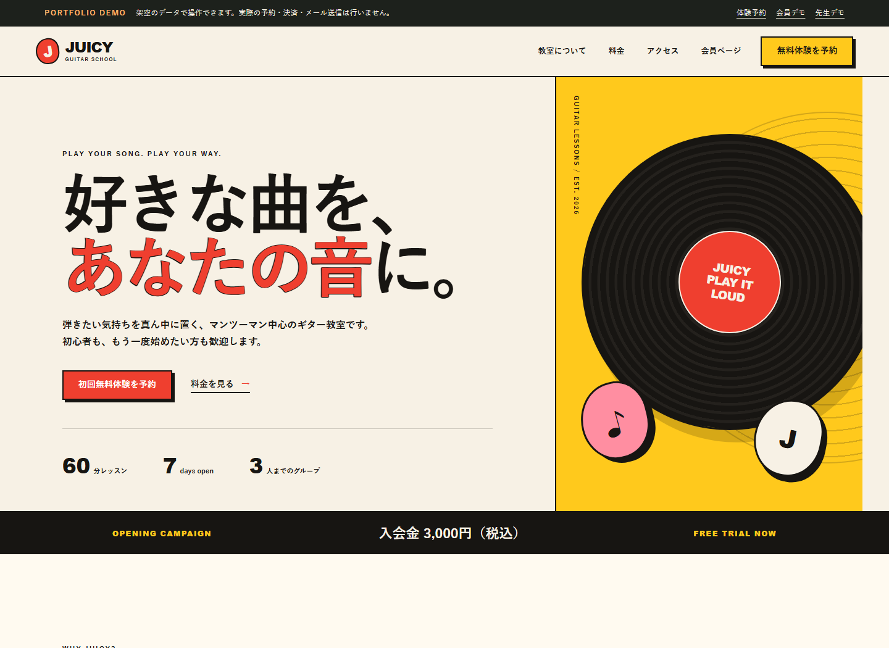
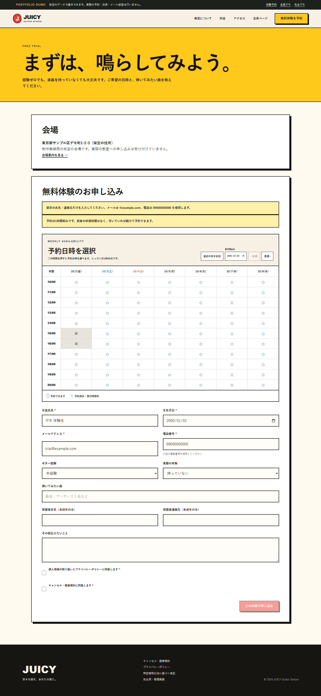
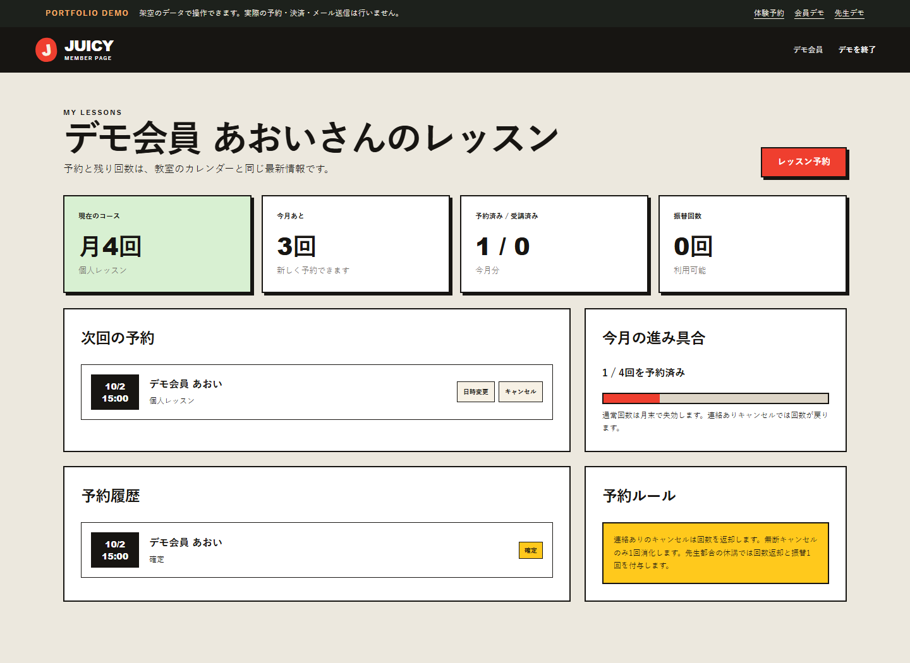
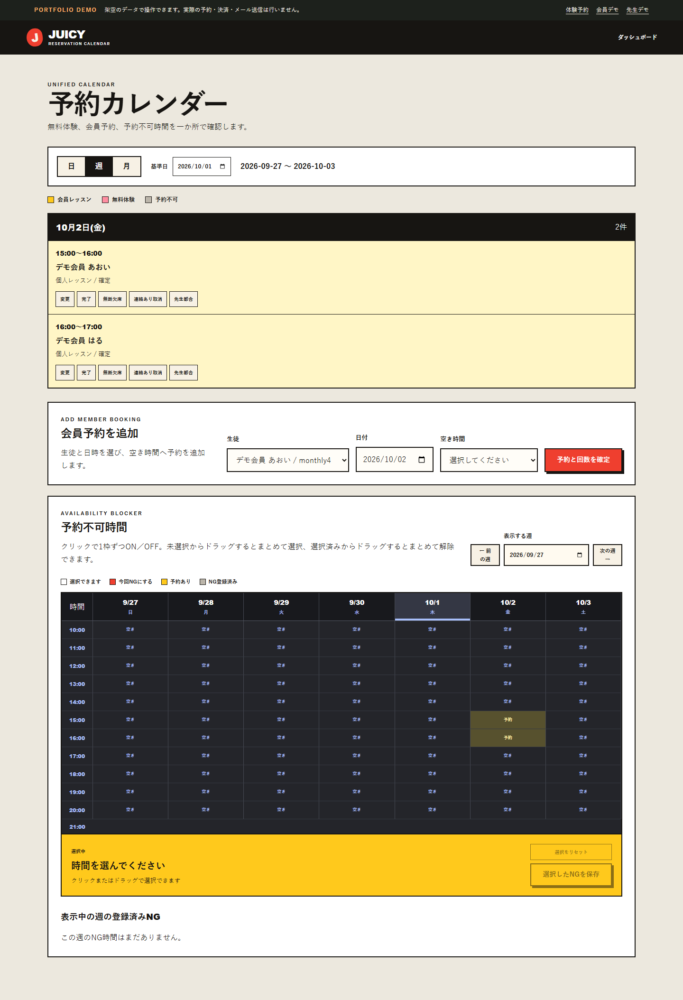
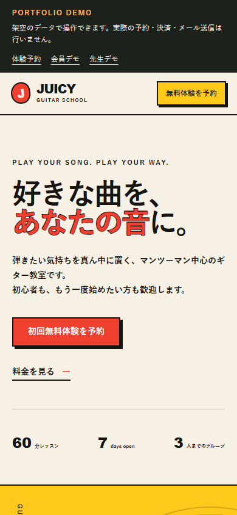

# JUICY ギター教室 予約サイト

ギター教室の無料体験申し込みから、会員レッスン予約、教室側の予約管理までをつなぐ予約サイトです。利用者には予約と残り回数を分かりやすく、教室には体験・会員予約をまとめて扱える画面を提供することを目的に制作しました。

実装範囲は、利用者向けUI、予約API、データベース設計、管理画面です。

## 主な機能と設計

- 無料体験の申し込み、日時変更・キャンセル
- 会員の予約、月ごとの残り回数表示
- 管理画面での予約確認と、体験・会員レッスン共通のカレンダー
- 予約枠の一意制約をDBにも設け、同時操作による重複予約を防止
- 予約中・受講済みの状態に応じた回数計算と、キャンセル時の回数返却
- 会員・管理者の権限分離と、予約操作の再送を考慮した処理

## 技術スタック

| 領域 | 技術 |
| --- | --- |
| UI・言語 | React、TypeScript |
| 開発・ルーティング | Vite、vinext |
| データベース | Cloudflare D1、Drizzle ORM、SQLite |
| 品質確認 | Node.js test runner、ESLint、TypeScript |

## 画面例

| トップ・PC | 無料体験・PC |
| --- | --- |
|  |  |

| 会員ページ・PC | 管理カレンダー・PC |
| --- | --- |
|  |  |



## ローカルデモ

Node.js 22.18 以上で起動できます。

```bash
npm ci
npm run demo:setup
npm run dev
```

`http://127.0.0.1:3000` を開きます。管理者・会員表示は `/demo?role=admin`、`/demo?role=member` で切り替えられます。デモには架空データを使い、メール送信や決済は行いません。

## 確認した範囲

`npm run check` で30件の自動チェック、lint、型確認、ビルドを実行できます。加えてローカル環境で主要5画面の表示と、HTTP経由の9項目（予約・変更・キャンセル、回数返却、権限・重複予約のチェックなど）を確認済みです。
